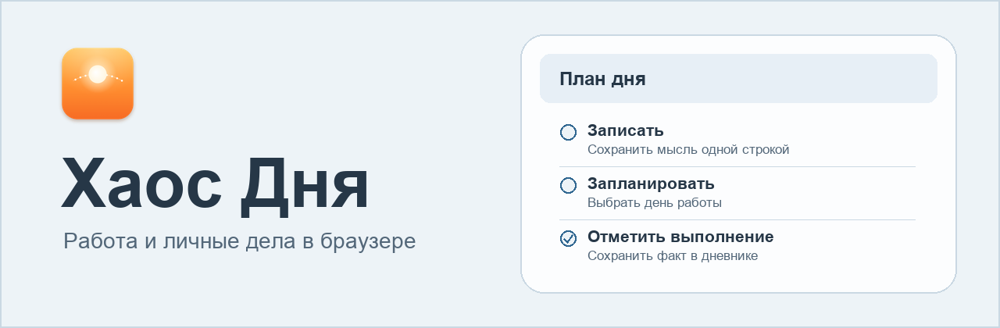

  

# Хаос Дня

**Органайзер рабочих и личных задач для Windows и Linux.** Веб-версия в разработке.

[О рабочем дне](#как-проходит-рабочий-день) · [Первый выпуск](#первый-выпуск) · [Версия для Mac](https://github.com/pravoslavnaacerkovukrainy-tech/daylog/releases/tag/v0.2.14)

## Как проходит рабочий день

В четверг Ира просит прислать правки к смете до пятницы. Ты записываешь это одной строкой в «Место хаоса». Позже превращаешь запись в задачу и ставишь её в план на четверг.

Срочный звонок занимает остаток дня. Ты переносишь работу на пятницу и видишь обещанный срок рядом с новым планом. После отправки сметы отмечаешь выполнение. В дневнике появляется запись с временем отметки.

| Что нужно сделать | Где открыть |
| --- | --- |
| Быстро записать мысль и разобрать её позже | **Место хаоса** |
| Выбрать день работы и проверить сроки | **План** |
| Продвинуть проект или проверить ожидаемый ответ | **Проекты** и **Ожидаю** |
| Понять, какие обещания затронула перемена планов | **Обзор** |
| Сохранить справку или точку продолжения | **Заметки** и **Дневник** |

## Три даты у задачи

- **День работы** отвечает за то, когда взяться за дело. Его меняет команда «Перенести».
- **Срок результата** показывает, к какому дню нужен итог.
- **Дата пересмотра** задаёт день, когда проверить условия и выбрать продолжение.

В плане на сегодня видны назначенные дела, незавершённое с прошлых дней, наступившие сроки и дела под угрозой. «Обзор» собирает обещания и ожидания в одном порядке, чтобы их можно было проверить после сбоя.

## Первый выпуск

Первый выпуск рассчитан на одного пользователя. В браузере можно будет вести дела, проекты и заметки Markdown, возвращаться к сохранённому плану и смотреть факты в дневнике. Для перехода с Mac предусмотрен импорт архива. Сохранённые данные можно будет выгрузить в JSON и Markdown.

Сначала веб-версия пройдёт локальную приёмку. Затем планируются размещение на собственном сервере и синхронизация с Mac. Пока доступно [приложение для Mac](https://github.com/pravoslavnaacerkovukrainy-tech/daylog/releases/tag/v0.2.14).
